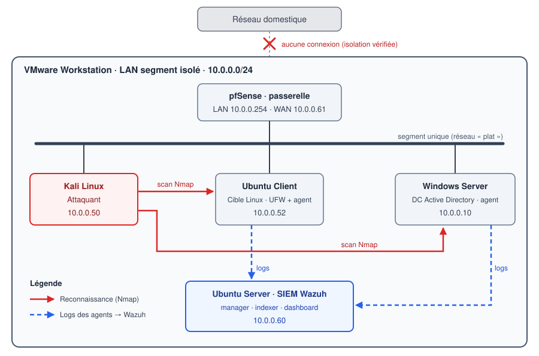

# Home lab SOC

Laboratoire de cybersécurité défensive que j'ai construit pour apprendre le métier
d'analyste SOC : attaquer dans un environnement contrôlé, mesurer ce que la défense
voit réellement, puis **concevoir, tester et valider des détections**.

Chaque projet suit la même démarche : préparer et vérifier le lab, attaquer, constater
ce que le SIEM détecte (ou non), améliorer la détection, puis valider en conditions
réelles, en documentant aussi les échecs et les limites.

## Architecture



| Machine | Rôle | Adresse IP |
|---|---|---|
| Kali Linux | Attaquant | `10.0.0.50` |
| pfSense | Routeur et pare-feu du lab | `10.0.0.254` (LAN) · `10.0.0.61` (WAN) |
| Ubuntu Client | Cible Linux (agent Wazuh) | `10.0.0.52` |
| Windows Server | Contrôleur de domaine Active Directory (agent Wazuh) | `10.0.0.10` |
| Ubuntu Server | Serveur Wazuh (SIEM) | `10.0.0.60` |

Le lab tourne sous VMware Workstation, sur un réseau virtuel **isolé** de mon réseau
personnel.

## Projets

| # | Projet | Résumé | Statut |
|---|---|---|---|
| 1 | [Reconnaissance réseau & détection](projet-1-recon-detection/) | Reconnaissance Nmap et analyse Wireshark, démonstration de trois angles morts du SIEM, puis détection d'un scan de ports par un décodeur et deux règles Wazuh personnalisés, validée en conditions réelles | Terminé |
| 2 | [Attaque d'authentification & détection](projet-2-auth-attack/) | — | À venir |
| 3 | [Investigation SOC](projet-3-soc-investigation/) | — | À venir |

## Organisation du dépôt

```
soc-homelab/
├── architecture/              # schéma réseau du lab
├── projet-1-recon-detection/
│   ├── README.md              # synthèse du projet
│   ├── RAPPORT.md             # rapport technique complet
│   ├── config/wazuh/          # décodeur et règles Wazuh personnalisés
│   └── screenshots/           # captures, classées par étape
├── projet-2-auth-attack/      # à venir
└── projet-3-soc-investigation/ # à venir
```

## Outils

Kali Linux · Nmap · Wireshark · pfSense · UFW · Wazuh · Windows Server / Active
Directory · VMware Workstation · Git

## Cadre

Toutes les attaques sont menées **uniquement dans ce lab isolé**, sur des machines qui
m'appartiennent, à des fins d'apprentissage. Les adresses `10.0.0.x` sont celles d'un
réseau privé de lab. Dans les captures, l'adresse IP de mon réseau personnel a été
masquée ; les autres informations visibles (noms de machines, adresses MAC) sont propres
au lab.
