← [Retour à la synthèse](README.md)

# Projet 1 – Reconnaissance réseau & détection

> **Home lab SOC** · Kali Linux · pfSense · Ubuntu · Windows Server (Active Directory) · Wazuh · Wireshark · Nmap · UFW

Dans un lab virtualisé et isolé, j'ai mené une reconnaissance réseau depuis Kali
(découverte des hôtes, puis scan de ports d'un poste Linux et d'un contrôleur de
domaine) et vérifié ce que le SIEM Wazuh en voyait : **aucune alerte**. Pour combler cet
angle mort sur le poste Linux, j'ai activé la journalisation du pare-feu UFW et écrit
**un décodeur et deux règles Wazuh**. Le scan est désormais détecté et sa source
identifiée (`10.0.0.50`). Malgré un test unitaire réussi, aucune alerte n'arrivait
lors d'un vrai scan : j'en ai retenu qu'une détection doit toujours **être validée en
conditions réelles**.

## Sommaire

1. [Objectifs](#objectifs)
2. [Architecture du lab](#architecture)
3. [Préparation](#preparation)
4. [Reconnaissance](#reconnaissance)
5. [Analyse réseau](#analyse-reseau)
6. [Angles morts : ce que Wazuh n'a pas vu](#angles-morts)
7. [Rendre le scan visible](#ingenierie-detection)
8. [Résultats](#resultats)
9. [Dépannage et leçons apprises](#depannage)
10. [Limites et améliorations](#limites)

<a id="objectifs"></a>
## Objectifs

1. Comprendre **ce que voit un attaquant** quand il explore un réseau.
2. Vérifier **ce que voit (ou ne voit pas) le défenseur** pendant ce temps.
3. **Rendre visible** ce que le défenseur ne voyait pas, en écrivant mes propres règles.
4. **Prouver** que ça marche avec une vraie attaque, pas seulement en test.

**Techniques MITRE ATT&CK couvertes**

| ID | Technique | Dans ce projet |
|---|---|---|
| [T1018](https://attack.mitre.org/techniques/T1018/) | Remote System Discovery | Recherche des machines du réseau (`nmap -sn`, ARP) |
| [T1046](https://attack.mitre.org/techniques/T1046/) | Network Service Discovery | Scan de ports d'Ubuntu et du contrôleur de domaine |

<a id="architecture"></a>
## Architecture du lab

Le lab tourne sous **VMware Workstation**, sur un réseau **isolé de mon réseau
personnel** (vérifié dans la [Préparation](#preparation)).


| Machine | Rôle | Adresse IP | Surveillée par Wazuh |
|---|---|---|---|
| Kali Linux | Attaquant | `10.0.0.50` | — |
| pfSense | Routeur et pare-feu du lab | `10.0.0.254` (LAN) · `10.0.0.61` (WAN) | — |
| Ubuntu Client | Cible Linux | `10.0.0.52` | Oui |
| Windows Server | Contrôleur de domaine (cible Windows) | `10.0.0.10` | Oui |
| Ubuntu Server | Serveur Wazuh (reçoit et analyse tout) | `10.0.0.60` | serveur |

<a id="preparation"></a>
## Préparation : vérification du lab

Vérifications effectuées :

- les machines ont les bonnes adresses et communiquent entre elles ;
- Wazuh reçoit bien les informations des deux machines surveillées (Ubuntu et Windows) ;
- une action simple sur Ubuntu (une commande `sudo`) crée bien une alerte dans Wazuh ;
- le lab ne peut pas atteindre mon réseau personnel.

<details>
<summary>Captures de la préparation</summary>

**Wazuh reçoit les deux machines**

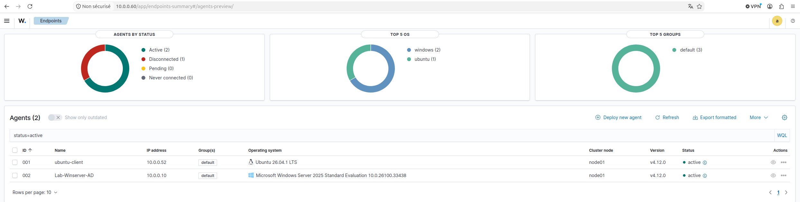

*La machine « Disconnected » est un poste Windows prévu pour un autre projet.*

**Le lab est isolé** : le ping vers le PC hôte échoue

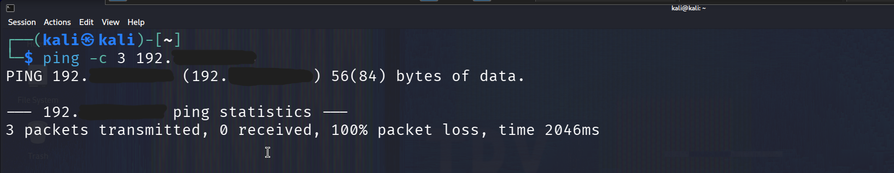

*L'adresse de mon PC est masquée.*

</details>

<a id="reconnaissance"></a>
## Reconnaissance

### Trouver les machines du réseau

Découverte des hôtes actifs depuis Kali :

```bash
nmap -sn 10.0.0.0/24
```

`-sn` : découverte sans scan de ports, par requêtes ARP sur le réseau local.

| Adresse trouvée | Machine |
|---|---|
| `10.0.0.10` | Windows Server (contrôleur de domaine) |
| `10.0.0.52` | Ubuntu Client |
| `10.0.0.60` | Ubuntu Server (Wazuh) |
| `10.0.0.61` | pfSense (côté WAN) |
| `10.0.0.254` | pfSense (côté LAN) |
| `10.0.0.50` | Kali (la machine qui scanne) |

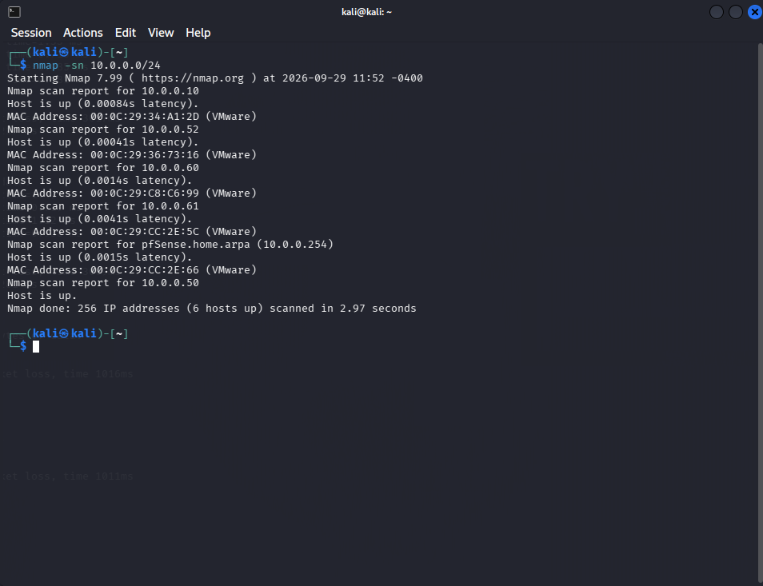

### Scanner les ports

Scan des 1000 ports TCP les plus courants sur les deux cibles :

```bash
nmap 10.0.0.52
nmap 10.0.0.10
```

| Cible | Résultat | Ce que ça veut dire |
|---|---|---|
| Ubuntu Client | **aucun port ouvert** | Rien à attaquer depuis le réseau |
| Windows Server | **12 ports ouverts** | C'est un contrôleur de domaine, la machine la plus importante d'un réseau Windows |

Quatre ports suffisent à reconnaître un contrôleur de domaine :

- **88 (Kerberos)** : sert à se connecter au domaine ;
- **389 (LDAP)** : l'annuaire des utilisateurs et des groupes ;
- **445 (SMB)** : le partage de fichiers ;
- **3268 (Global Catalog)** : la recherche dans tout l'annuaire.

> **`closed` et `filtered`, ce n'est pas pareil.** Sur Ubuntu, les ports sont `closed` :
> la machine répond « il n'y a rien ici ». Elle est donc bien là. Un port `filtered`,
> lui, ne répond pas du tout : un pare-feu bloque.

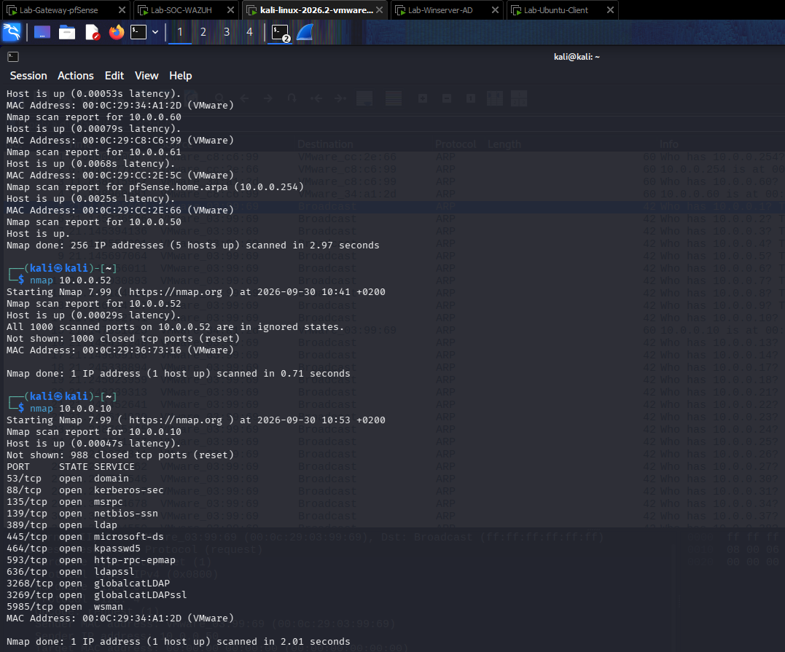

<a id="analyse-reseau"></a>
## Analyse réseau : à quoi ressemble un balayage

Pendant la découverte des hôtes, j'ai capturé le trafic ARP avec **Wireshark** afin
d'identifier la signature d'un balayage côté défense.

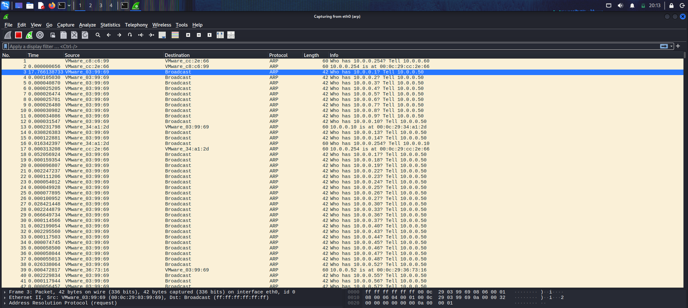

### Trois signes qui trahissent un balayage

| Signe | Ce qu'on voit dans la capture |
|---|---|
| **Une seule source** | Toutes les questions viennent de Kali (`10.0.0.50`) |
| **Des adresses qui se suivent** | Kali demande `10.0.0.1`, puis `.2`, `.3`… jusqu'à `.254` |
| **Très rapide** | Les questions partent toutes les 0,03 à 0,3 milliseconde : aucun humain ne peut aller aussi vite |

Le graphique de Wireshark (**Statistics → I/O Graphs**) le montre bien : environ
**250 questions en une seconde**, et presque rien le reste du temps.

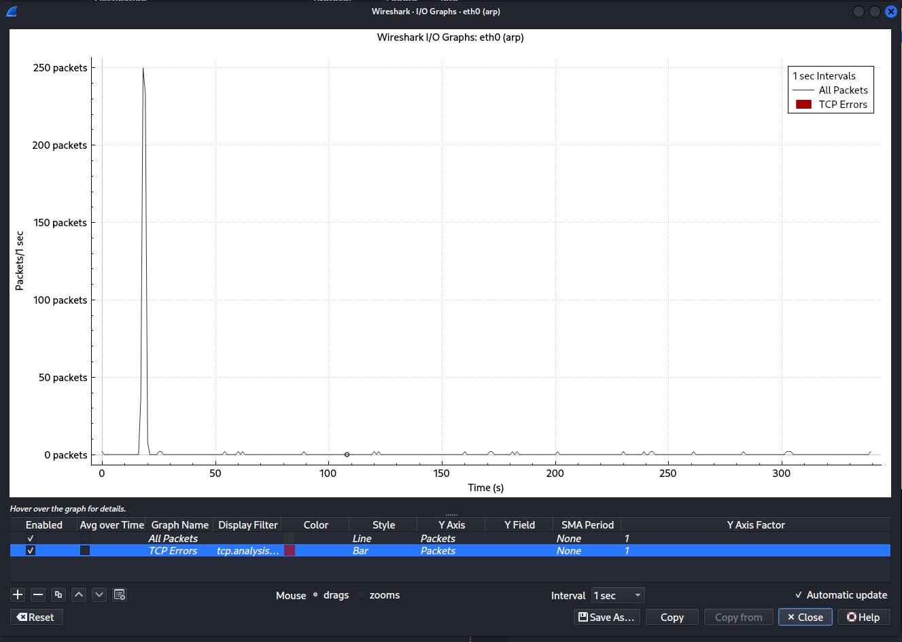

### Trafic normal ou balayage ?

La capture contient aussi du trafic ARP **normal** : le serveur Wazuh et le contrôleur
de domaine demandent l'adresse de leur passerelle, une seule fois. Le balayage, lui,
pose la question à **toutes** les adresses possibles. Seules les machines allumées
répondent.

> **Pourquoi Wazuh ne voit rien :** les machines n'enregistrent pas les questions ARP
> qu'elles reçoivent dans leurs journaux. Or Wazuh lit justement ces journaux. Il n'a
> donc aucune trace de ce balayage. La section suivante le montre.

<a id="angles-morts"></a>
## Angles morts : ce que Wazuh n'a pas vu

Après la reconnaissance, j'ai regardé dans Wazuh ce qu'il avait enregistré au moment de
chaque action.

| Action depuis Kali | Heure | Machine surveillée | Alerte dans Wazuh |
|---|---|---|---|
| Recherche des machines (ARP) | juste avant 10:41 | Ubuntu Client | Aucune |
| Scan de ports d'Ubuntu | 10:41 | Ubuntu Client | Aucune |
| Scan de ports du contrôleur de domaine | 10:53 | Windows Server | Aucune |

**Wazuh n'a rien vu des trois actions.**

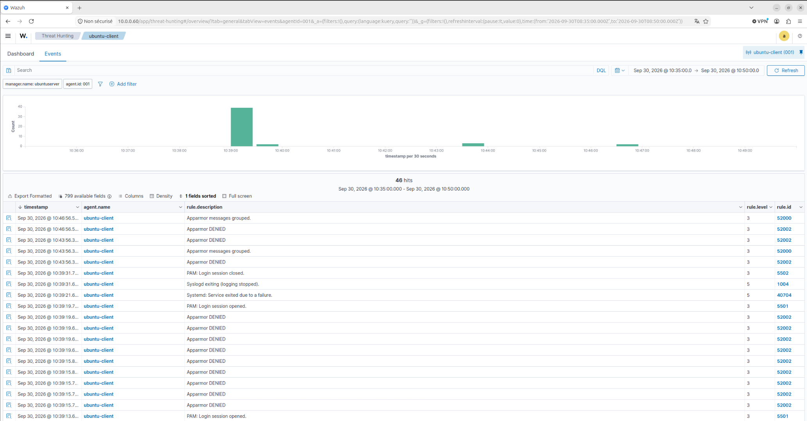

*Ubuntu : rien à 10:41, au moment du scan. Les autres événements de la période
concernent la machine elle-même, pas le réseau.*

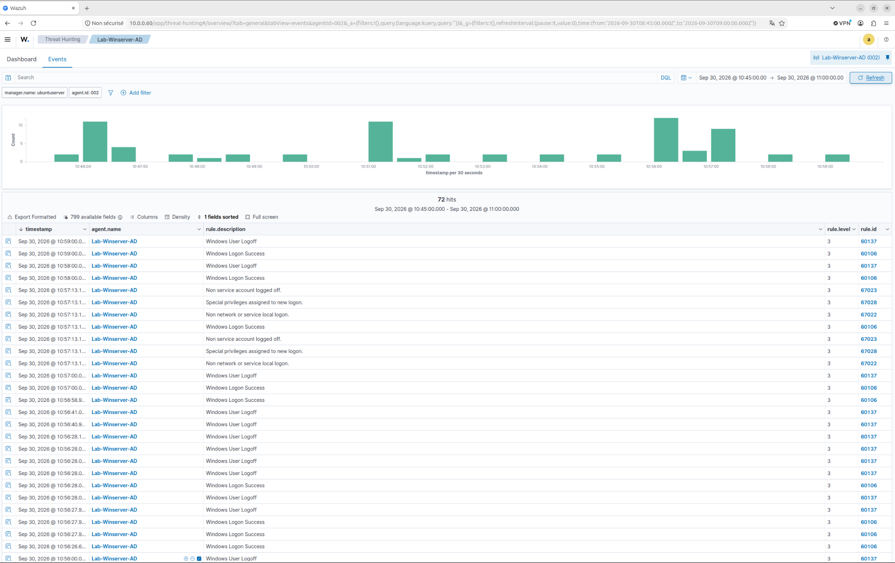

*Windows : à 10:53, on ne voit que les 2 événements qui reviennent toutes les minutes
(une connexion automatique de Windows). Le scan de 1000 ports n'ajoute rien.*

### Pourquoi c'est invisible

Wazuh lit les **journaux des machines**. Pour qu'il y ait une alerte, il faut d'abord
qu'une ligne soit écrite dans un journal. Or :

- **ARP** : déjà expliqué plus haut, rien n'est écrit.
- **Scan d'Ubuntu** : les ports sont fermés, Linux répond tout seul « rien ici », sans
  rien écrire. Il n'y a pas de pare-feu qui enregistre les tentatives.
- **Scan de Windows** : Nmap vérifie seulement si chaque port répond, puis il coupe tout
  de suite, sans essayer de se connecter. Les services n'ont donc rien à enregistrer.

> **Pas d'alerte ne veut pas dire pas d'attaque.** Je peux l'affirmer parce que j'avais
> vérifié avant que Wazuh fonctionnait bien (voir [Préparation](#preparation)) : il
> marchait, il ne *voyait* simplement rien.
>
> Pour rendre le scan visible, il faut qu'il **laisse une trace dans un journal**. C'est
> le but de la section suivante.

<a id="ingenierie-detection"></a>
## Ingénierie de détection : rendre le scan visible

Pour que Wazuh voie le scan d'Ubuntu, il faut qu'il laisse une trace. J'ai donc construit
une chaîne en 5 étapes :

```
Kali scanne ──► le pare-feu bloque et écrit une ligne ──► Wazuh lit la ligne ──► il la comprend ──► il décide d'alerter
```

### 1. Créer une trace : le pare-feu UFW

Sur Ubuntu, j'ai activé le pare-feu **UFW** et je lui ai demandé d'enregistrer ce qu'il
bloque :

```bash
sudo ufw enable           # active le pare-feu
sudo ufw logging medium   # enregistre ce qui est bloqué (remis en "low" à la fin du projet)
```

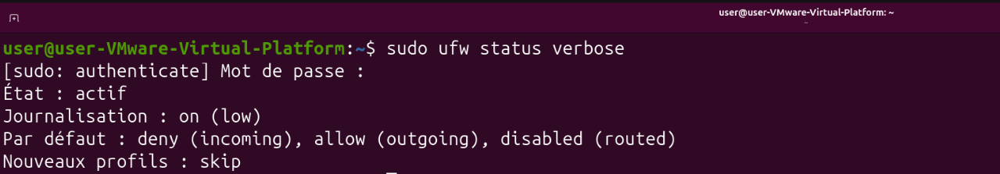

Désormais, chaque tentative bloquée écrit une ligne dans le fichier `/var/log/ufw.log` :

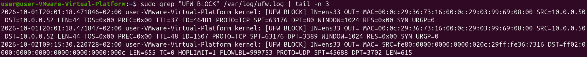

*Les deux premières lignes viennent du scan de Kali (`SRC=10.0.0.50`). La troisième est
du trafic normal, bloqué lui aussi : tout ce qui est bloqué n'est pas une attaque.*

### 2. Lire la trace : Wazuh surveille le fichier

Par défaut, Wazuh ne lit pas ce fichier. J'ai ajouté ces lignes dans sa configuration
sur Ubuntu (`/var/ossec/etc/ossec.conf`) :

```xml
<localfile>
  <log_format>syslog</log_format>
  <location>/var/log/ufw.log</location>
</localfile>
```

### 3. Comprendre la trace : un décodeur

Wazuh reçoit la ligne, mais il ne sait pas la lire : son décodeur prévu pour les
pare-feu ne reconnaît pas le format d'UFW. J'ai donc écrit **mon propre décodeur**. Il
découpe la ligne et en extrait 6 informations : l'action (`BLOCK`), l'adresse de
l'attaquant, l'adresse de la cible, le protocole et les deux ports.

Fichier : [`config/wazuh/local_decoder.xml`](config/wazuh/local_decoder.xml)

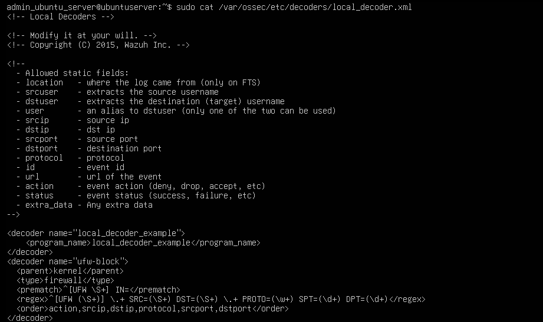

### 4. Décider d'alerter : deux règles

| Règle | Gravité | Se déclenche quand… | Rôle |
|---|---|---|---|
| **100100** | 4 (faible) | le pare-feu bloque une tentative | Signaler **un** blocage |
| **100101** | 7 (plus forte) | **10 événements de blocage en 30 secondes** depuis la même machine | Détecter **un scan** (MITRE ATT&CK [T1046](https://attack.mitre.org/techniques/T1046/)) |

Un blocage seul, c'est banal. Beaucoup de blocages très vite depuis la même machine,
c'est un scan. C'est pour ça que la deuxième règle est plus grave, et c'est aussi elle
qui permet d'ignorer le trafic normal.

Fichier : [`config/wazuh/local_rules.xml`](config/wazuh/local_rules.xml)

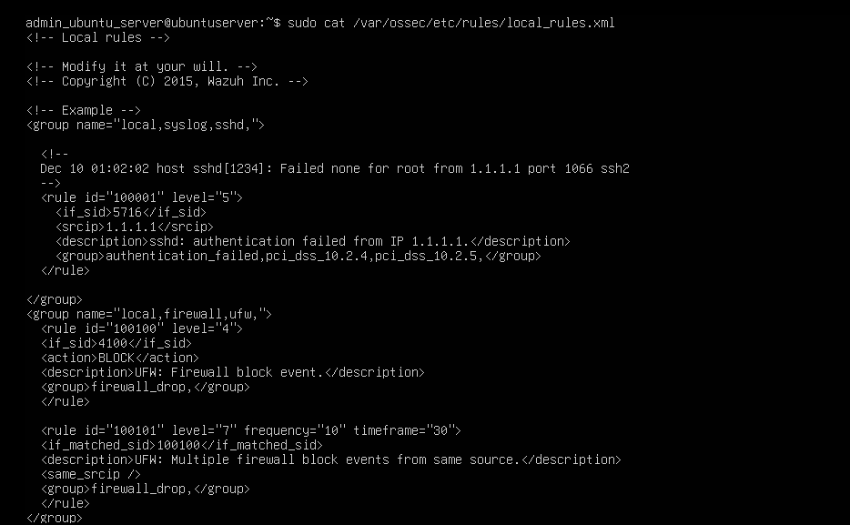

### 5. Tester : `wazuh-logtest`

L'outil `wazuh-logtest` permet de tester une ligne sans lancer de vraie attaque. Je lui
ai donné une vraie ligne de blocage venant du scan de Kali :

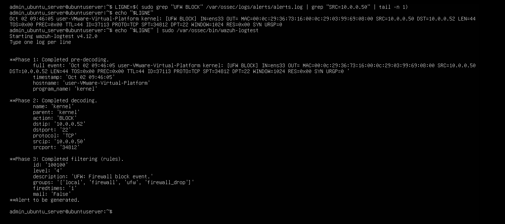

> **Un test réussi ne suffit pas.** Avec une version précédente de mon décodeur,
> incomplète, ce test affichait **déjà** `Alert to be generated`… mais pendant un vrai
> scan, aucune alerte ne remontait. La vraie preuve, ce sont les alertes réelles de la section
> [Résultats](#resultats). La section [Dépannage](#depannage) raconte comment j'ai trouvé
> le problème.

<a id="resultats"></a>
## Résultats

J'ai relancé l'attaque depuis Kali avec tout en place : un scan ciblé de 3 ports
(`nmap -p 22,80,443 10.0.0.52`) et un scan complet de 1000 ports (`nmap 10.0.0.52`).

### Le scan est détecté

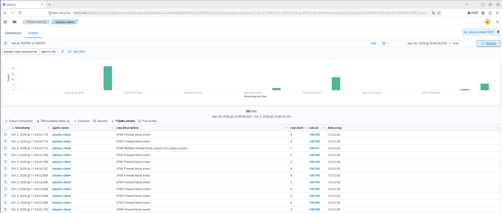

*Les alertes 100100 et 100101 sont bien remontées dans Wazuh.*


L'alerte 100101 permet d'identifier :
- **le comportement** : au moins 10 événements de blocage en 30 secondes, soit un scan probable ;
- **la source** : `10.0.0.50` (Kali) ;
- **la cible** : `10.0.0.52` (Ubuntu Client).

### Le trafic normal ne déclenche pas d'alerte de scan

Le pare-feu bloque aussi du trafic normal : des messages qu'Ubuntu envoie lui-même sur
le réseau. Mais ces blocages arrivent par 2 à 4, jamais 10 d'un coup. Ils créent des
alertes 100100, mais **jamais d'alerte 100101**.

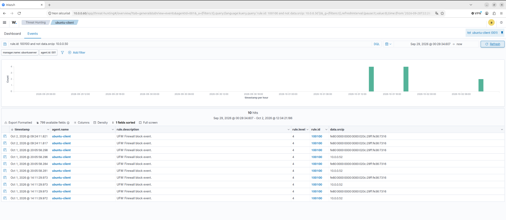

### Analyse critique des chiffres

La comparaison entre les alertes et les blocages réels révèle deux écarts.

**1. Presque chaque ligne est comptée deux fois.** Le scan ciblé a créé **6 blocages**,
mais Wazuh a reçu **11 événements** : 6 via le fichier `/var/log/ufw.log` ajouté, et 5
via le journal général du système (journald), qu'il lisait déjà.


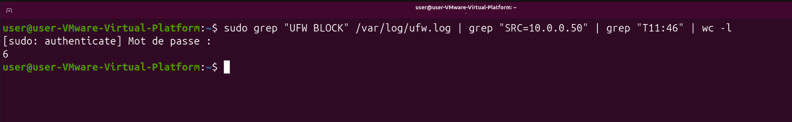

**2. Le pare-feu n'écrit qu'une petite partie du scan.** Pour le scan de 1000 ports,
UFW n'a écrit que **11 lignes**. Par défaut, il limite l'écriture à une rafale de
**10 lignes**, puis **3 par minute**.

| Scan | Tentatives envoyées | Lignes écrites par UFW | Événements dans Wazuh | Alertes de scan |
|---|---|---|---|---|
| Ciblé (3 ports) | 6 | 6 | 11 | 1 |
| Complet (1000 ports) | ≥ 1000 | 11 | 20 | 2 |

**Conséquences pour la détection :**
- **Seuil réel abaissé** : avec la double collecte, la règle 100101 se déclenche dès 5 blocages environ, au lieu de 10.
- **Ampleur invisible** : Wazuh détecte le scan, mais n'en voit qu'environ 1 %.
- **Scans lents non détectés** : un scan étalé sur plusieurs minutes n'atteint jamais le seuil de 10 événements en 30 secondes.

> **Bilan :** le scan d'Ubuntu, invisible au départ, est maintenant **détecté**, et on
> sait **d'où il vient**. Les limites ci-dessus et les solutions possibles sont dans la
> section [Limites et améliorations](#limites).

<a id="depannage"></a>
## Dépannage et leçons apprises

### Le symptôme : un test concluant, aucune alerte réelle

`wazuh-logtest` annonçait `Alert to be generated`, mais un vrai scan depuis Kali ne
faisait remonter **aucune alerte**. Aucun message d'erreur non plus : les événements
disparaissaient **silencieusement**.

### La méthode

**Étape 1 : où les lignes se perdent-elles ?**

| Question | Réponse |
|---|---|
| Le pare-feu écrit-il les lignes ? | ✅ Oui |
| Wazuh, sur Ubuntu, lit-il le fichier ? | ✅ Oui |
| Envoie-t-il les lignes au serveur Wazuh ? | ✅ Oui |
| Le serveur Wazuh les conserve-t-il ? | ❌ **Non** |

Les lignes se perdent donc **sur le serveur Wazuh**. Le fichier `archives.log`, qui
garde tout ce que le serveur reçoit, le confirme.

**Étape 2 : quelles lignes disparaissent ?**

Des **lignes de test** sont ajoutées dans `/var/log/ufw.log`, chacune avec une fausse
adresse pour la reconnaître. On regarde ensuite lesquelles arrivent sur le serveur.

| Ligne de test | Ce qu'elle contient | Arrive ? |
|---|---|---|
| Texte quelconque | n'importe quoi | ✅ Oui |
| **A** | le contenu d'une ligne UFW, sans le début `kernel:` | ✅ Oui |
| **B** | une vraie ligne UFW complète, avec `kernel:` | ❌ Non |
| **C** | comme B, mais avec un autre format de date | ❌ Non |
| **D** | un début de ligne différent, sans contenu UFW | ✅ Oui |

**Conclusion :** seules les lignes qui commencent par `kernel:` **et** contiennent du
UFW disparaissent. Ce sont **exactement les lignes lues par le décodeur**. La date n'y
est pour rien : B et C disparaissent toutes les deux.

### La cause : un décodeur incomplet

Une discussion sur le GitHub de Wazuh ([#11609](https://github.com/wazuh/wazuh/issues/11609))
décrit un cas proche : une ligne de pare-feu mal décodée est **jetée sans message
d'erreur**.

C'était le cas ici : le décodeur contenait des erreurs (par exemple `scrip` au lieu de
`srcip`) et n'extrayait pas toutes les informations. Wazuh jetait donc les lignes.
`wazuh-logtest` ne fait pas ce tri, d'où le test réussi. Une fois le décodeur corrigé,
les 6 informations sont bien extraites et les alertes apparaissent.

### Leçons apprises

1. **Un test réussi ne suffit pas.** Une détection doit être validée avec une vraie
   attaque.
2. **Sans message d'erreur, on cherche par élimination.** Les lignes de test ont permis
   de trouver le problème.
3. **Il faut vérifier ses chiffres.** Comparer les alertes aux blocages réels a révélé
   la double collecte et les lignes manquantes.

<a id="limites"></a>
## Limites et améliorations

| Problème | Ce que j'ai constaté | Ce que je pourrais faire |
|---|---|---|
| **Horloges pas à l'heure** | Ubuntu prenait du retard à chaque mise en veille : **8 minutes** lors du scan ciblé, puis **2 h 34** lors du scan complet, le même jour. Kali n'était pas non plus sur le bon fuseau horaire au départ. | Mettre toutes les machines à l'heure avec un serveur de temps (**NTP**) sur pfSense, et le même fuseau horaire partout |
| **Lignes comptées deux fois** | Wazuh lit presque chaque blocage à deux endroits : la règle de scan se déclenche après environ 5 blocages au lieu de 10 | Ne lire les lignes du pare-feu qu'à un seul endroit, puis réajuster la règle |
| **Le pare-feu n'écrit pas tout** | 11 lignes seulement pour un scan de 1000 ports ; un scan lent passerait inaperçu | Augmenter le niveau d'enregistrement d'UFW, ou rallonger la durée de la règle |
| **Détection limitée à Ubuntu** | La détection créée ne couvre que l'Ubuntu Client : le scan du Windows et la recherche ARP restent invisibles | Activer l'enregistrement des connexions sur Windows et l'envoyer à Wazuh |
| **Wazuh ne voit pas le réseau** | Il ne voit que ce que les machines écrivent dans leurs journaux | Ajouter un outil qui surveille directement le réseau (**Suricata**) et envoie ses alertes à Wazuh. Il verrait tout, même la recherche ARP |
| **Toutes les machines sur le même réseau** | pfSense ne filtre rien entre les machines | Séparer le lab en plusieurs réseaux (postes, serveurs, SOC) |

### Prochaines étapes

1. **Mettre les horloges à l'heure** : sans ça, impossible de comparer correctement
   les événements de plusieurs machines.
2. **Corriger le double comptage** et réajuster la règle de scan.
3. **Installer Suricata** pour voir le trafic réseau directement.