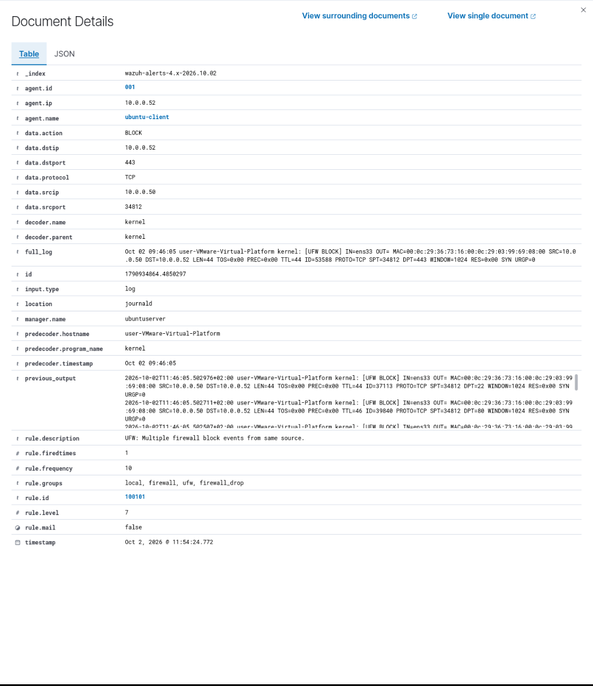
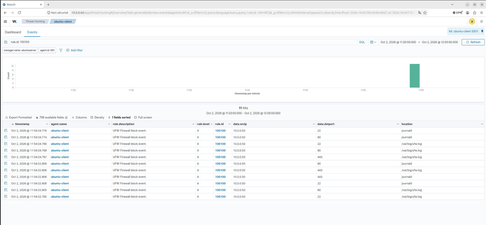

# Projet 1 – Reconnaissance réseau & détection

> **Home lab SOC** · Kali Linux · pfSense · Ubuntu · Windows Server (Active Directory) · Wazuh · Wireshark · Nmap · UFW

**[Rapport technique complet](RAPPORT.md)** · **[Décodeur et règles Wazuh](config/wazuh/)**

## En bref

- **Contexte** : un lab SOC isolé de 5 machines, dans lequel je joue l'attaquant puis le
  défenseur.
- **Constat** : une reconnaissance réseau avec Nmap (découverte d'hôtes, scans de ports)
  ne déclenche **aucune alerte** dans le SIEM Wazuh. J'ai démontré 3 angles morts.
- **Solution** : sur le client Linux, journalisation du pare-feu UFW, puis **décodeur et
  règle de corrélation Wazuh personnalisés** : 10 événements de blocage en 30 s depuis une même
  source signalent un scan (MITRE ATT&CK T1046).
- **Difficulté** : le test unitaire passait, mais aucune alerte ne remontait en conditions
  réelles : le décodage était incomplet, et Wazuh écartait les événements sans message
  d'erreur.
- **Résultat** : le scan est détecté et **sa source identifiée** (`10.0.0.50`). En
  confrontant les alertes aux blocages réels, j'ai aussi **mesuré les limites** de cette
  détection.

## Architecture

## Démarche

| Phase | Ce que j'ai fait | Résultat |
|---|---|---|
| [1. Préparation](RAPPORT.md#preparation) | Vérification de la connectivité, des agents, de la remontée des événements et de l'isolation | Lab opérationnel et isolé |
| [2. Reconnaissance](RAPPORT.md#reconnaissance) | Découverte d'hôtes (`nmap -sn`) et scans de ports | Machines du réseau et services du contrôleur de domaine identifiés |
| [3. Analyse réseau](RAPPORT.md#analyse-reseau) | Capture Wireshark du balayage | Signature d'un balayage identifiée |
| [4. Angles morts](RAPPORT.md#angles-morts) | Contrôle du dashboard Wazuh sur le créneau de chaque attaque | **Aucune alerte** dans Wazuh |
| [5. Détection](RAPPORT.md#ingenierie-detection) | UFW journalisé, collecte par l'agent, décodeur et règles 100100 / 100101 | Décodeur et règles fonctionnels en test |
| [6. Validation](RAPPORT.md#resultats) | Scans rejoués | **Scan détecté** et attaquant identifié |

## Résultat clé

*L'alerte de corrélation 100101 (niveau 7) : 10 événements de blocage depuis `10.0.0.50`, la machine
de l'attaquant.*

**Analyse critique des chiffres :** en comparant les alertes aux blocages réels,
j'ai découvert que chaque ligne de log était **presque toujours collectée deux fois** (fichier
`ufw.log` + journald), et qu'UFW ne journalise qu'**une petite partie** d'un scan.

| Scan | Tentatives envoyées | Lignes écrites par UFW | Événements dans Wazuh | Alertes de scan |
|---|---|---|---|---|
| Ciblé (3 ports) | 6 | 6 | 11 | 1 |
| Complet (1000 ports) | ≥ 1000 | 11 | 20 | 2 |

Le seuil réel de la règle est donc d'environ 5 blocages au lieu de 10, et le SIEM ne voit
qu'environ 1 % du scan. Les corrections sont proposées dans les
[limites et améliorations](RAPPORT.md#limites).

## Ce que j'ai appris

1. **Un test qui marche ne prouve pas que tout marche** : il faut tester avec une vraie
   attaque, du début à la fin.
2. **Quand il n'y a aucun message d'erreur, on cherche par élimination** : des lignes de
   test m'ont permis de trouver le problème en quelques essais.
3. **Il faut vérifier ses propres chiffres** : en comparant les alertes aux blocages
   réels, j'ai trouvé la double collecte et les lignes manquantes.

## Compétences démontrées

Reconnaissance réseau (Nmap) · Analyse de trafic (Wireshark) · Évaluation de la
couverture de détection · Ingénierie de détection Wazuh (décodeur, corrélation) ·
Diagnostic méthodique · Esprit critique sur ses résultats

**MITRE ATT&CK :** [T1018](https://attack.mitre.org/techniques/T1018/) Remote System
Discovery · [T1046](https://attack.mitre.org/techniques/T1046/) Network Service Discovery

---

**[Lire le rapport technique complet](RAPPORT.md)** : captures, décodeur et règles,
dépannage pas à pas, limites et améliorations.
